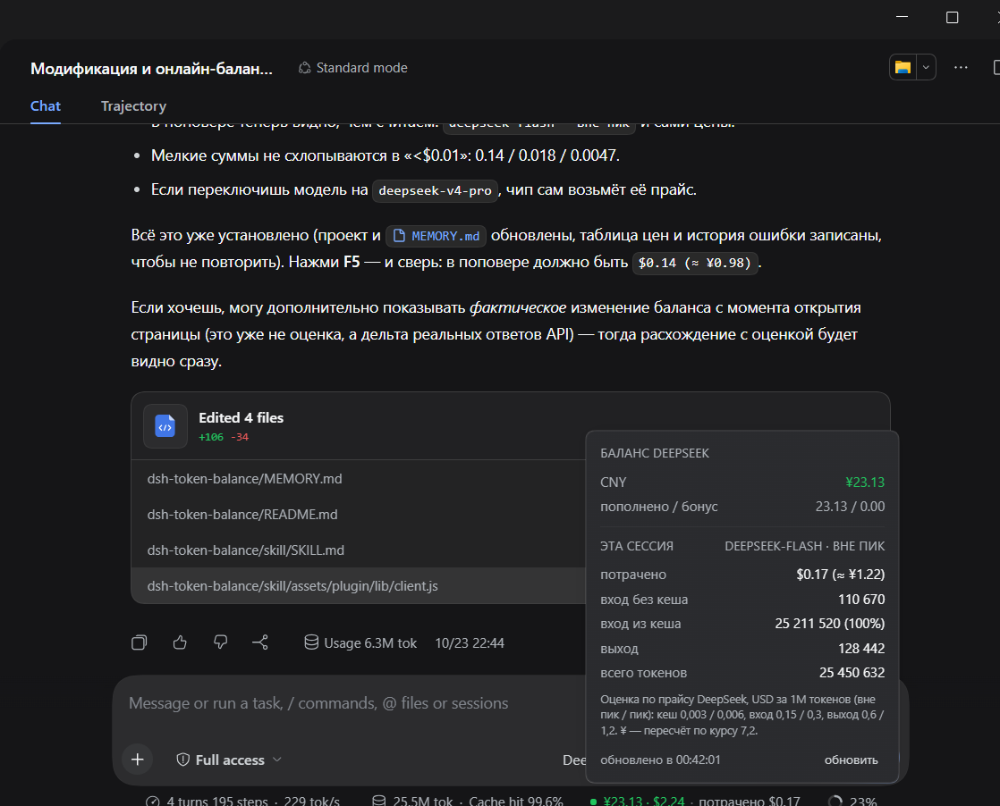
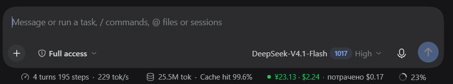
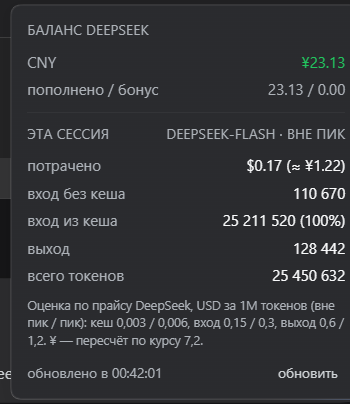
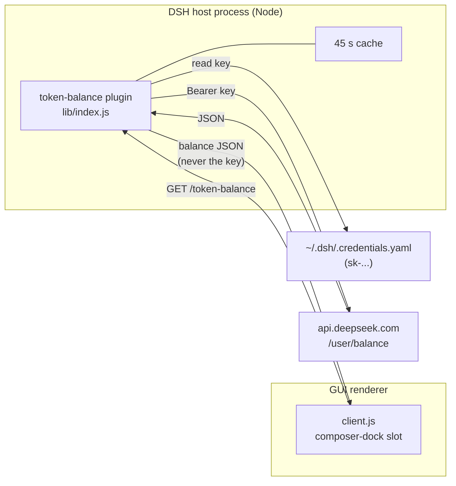

# DeepSeek Balance

**Live DeepSeek balance and estimated session spend inside the [DeepSeek Harness](https://github.com/deepseek-ai/deepseek-harness) chat panel.**


<sub>Repository: `deepseek-balance` · plugin & skill id: `dsh-token-balance` · Русская версия: [README.ru.md](README.ru.md)</sub>



---

## Why

DeepSeek Harness already shows token counts and cache statistics under the message
box — but never the money. You find out what a long session cost only by opening the
DeepSeek billing page.

This plugin puts both numbers where you already look: one line under the composer.

```
● ¥23.13 · $2.24 · потрачено $0.17
```

- **`¥23.13 · $2.24`** — the live balance from `GET https://api.deepseek.com/user/balance`
  for both currencies the API reports (green dot = last request OK).
- **`потрачено $0.17`** — what *this session* has cost so far, estimated from the
  provider-reported token counts and the official DeepSeek price list.

Click the line for the full breakdown.

## What you see

**In the composer dock** — the chip sits next to the built-in turn/step and token
statistics, so nothing is duplicated:



**In the popover** (click the chip) — balance split, per-session spend in USD and ¥,
cache-hit ratio, uncached input, cache read/write, output, total tokens, the last
refresh time, a manual refresh button, and the exact prices used for the estimate:



## Features

| | |
|---|---|
| **Live balance** | Polls once a minute, 45 s server-side cache, manual refresh in the popover. |
| **Both currencies** | CNY and USD, looked up by currency code — never by array index. |
| **Exact token counts** | Taken from the provider-reported `tokenUsage` projection, not estimated. |
| **Peak/off-peak aware** | Picks the peak or off-peak price table from the current UTC time. |
| **Model aware** | Reads `modelSelection` from the session and uses that model's price row. |
| **Honest about money** | Spend is labelled as an estimate; ¥ is a labelled conversion (DeepSeek bills in USD). |
| **Degrades quietly** | Keeps the last good balance when the network or the API fails; the dot turns red. |
| **No build step** | A hand-written browser bundle for `window.__ModuleLoader__` — no bundler, no `node_modules`. |
| **Survives app updates** | Only the DSH profile is touched (`plugins/` + one patch row). `app.asar` is never modified. |
| **Reversible** | `uninstall.ps1` removes the patch row (with a backup), the plugin, and the skill. |

## Requirements

- DeepSeek Harness with the Web GUI (desktop app or `dsh web`), verified against
  **DSH Desktop 0.2.1-rc.2**.
- A DeepSeek API key in `<DSH_HOME>/.credentials.yaml` — the same key the harness uses.
  The chip reads it **on the host process** and never sends it to the browser.
- PowerShell 7 (`pwsh`) or Windows PowerShell 5.1.
- Outbound HTTPS to `api.deepseek.com` from the host process.

## Install

Three equivalent paths. All of them are **idempotent** — re-running only refreshes files.

**1. Let the assistant do it** (after the skill is installed):

> «поставь dsh-token-balance» / "install the token balance chip"

**2. Run the installer yourself:**

```powershell
powershell -ExecutionPolicy Bypass -File .\skill\scripts\install.ps1
```

**3. Double-click `install.cmd`** — it prefers `pwsh` and falls back to Windows PowerShell.

Then **reload the DeepSeek Harness window with `F5`**. Client bundles are read once at
page load, so an already-open window keeps rendering the old UI until it reloads.

The installer writes to exactly three places:

| Path | What |
|---|---|
| `<DSH_HOME>\profiles\<desktop\|web>\plugins\token-balance\` | the plugin (3 files) |
| `<DSH_HOME>\profiles\<desktop\|web>\cordis.patch.yml` | one marked `insert` row (timestamped backup first) |
| `<DSH_HOME>\skills\dsh-token-balance\` | the companion skill (skip with `-NoSkill`) |

`DSH_HOME` defaults to `%USERPROFILE%\.dsh`. Nothing inside the DSH installation, its
`app.asar`, or any `node_modules` is modified — so app updates do not break it.

### Verify

```powershell
# the host half is mounted and can reach the API
Invoke-WebRequest http://127.0.0.1:<port>/token-balance | Select-Object -Expand Content
# {"ok":true,"at":1792784049918,"available":true,
#  "balances":[{"currency":"USD","total":"2.24","granted":"0.00","toppedUp":"2.24"},
#              {"currency":"CNY","total":"23.93","granted":"0.00","toppedUp":"23.93"}]}

node --check skill/assets/plugin/lib/client.js   # client bundle parses
```

The port is the GUI URL port (`$env:DSH_WEB_URL`, usually printed by the app).

## How it works



- **Host half** — a plain Cordis plugin. It registers `GET /token-balance` on
  `ctx.webServer`, caches the upstream answer for 45 s, and deduplicates concurrent
  requests with an in-flight promise guard. Errors become `{ ok: false, error }` —
  `no-api-key`, `upstream-<status>`, or a message.
- **Client half** — a hand-written CommonJS bundle loaded by `window.__ModuleLoader__`.
  It registers one control in the `conversation.composer.dock` slot (`order: 2`) and
  reads the session's `tokenUsage` and `modelSelection` projections from the slot props.
  No build step, no dependencies beyond `react` / `react/jsx-runtime`, which the
  platform seeds.
- **Skill** — `skill/SKILL.md`, installed to `<DSH_HOME>/skills/`, so a future agent can
  install, verify, or remove the whole thing without re-deriving the details.

Deeper notes — patch semantics, slot contracts, the client-bundle format, and the traps
already paid for — live in [`MEMORY.md`](MEMORY.md) and
[`docs/ARCHITECTURE.md`](docs/ARCHITECTURE.md).

## Accuracy

Token counts are **exact** — they come from the provider-reported `tokenUsage`
projection. Money is an **estimate**: the client prices those tokens with the official
DeepSeek list prices in [`PRICES`](skill/assets/plugin/lib/client.js), USD per 1M tokens,
off-peak / peak:

| model | cache hit | cache miss | output |
|---|---|---|---|
| `deepseek-flash` (V4.1-Flash) | 0.003 / 0.006 | 0.15 / 0.30 | 0.60 / 1.20 |
| `deepseek-v4-pro` | 0.022 / 0.044 | 0.66 / 1.32 | 1.98 / 3.96 |

Peak runs 01:00–04:00 and 06:00–10:00 UTC, Monday–Friday, excluding Chinese public
holidays; everything else is off-peak at half price. The ¥ figure is a conversion at
**7.2 CNY/USD** — DeepSeek itself bills in USD, which is why the popover writes `≈ ¥`.

The price table was validated against a real balance drop: 18 985 856 cached input +
96 828 uncached + 107 807 output tokens priced at Flash off-peak came to **$0.136 ≈
¥0.98**, while the wallet actually fell **¥1.00** over the same window.

Update `PRICES` when DeepSeek changes them; the source link sits in the code comment.
Balance itself is a fact read from `GET /user/balance`, not an estimate.

## Security & privacy

- The balance route is bound to the harness webserver on `127.0.0.1`, answers only
  `GET`/`HEAD`, and sends no CORS headers — another web page cannot read the response.
- It returns **balances only**, never the API key, the key's prefix, or any other
  credential. The key is read inside the host process and used for one outbound request.
- Nothing is sent to any third party. There is no telemetry, no analytics, no remote
  endpoint other than `api.deepseek.com`.
- The plugin does not modify the DSH installation, and every `cordis.patch.yml` edit is
  preceded by a timestamped backup.
- Any process that can already talk to the loopback port can read the same numbers —
  that is the same trust boundary the harness itself has.

## Project layout

```
deepseek-balance\
  README.md, README.ru.md          user docs (EN / RU)
  MEMORY.md                        engineering notes and hard-won DSH details
  AGENTS.md                        pointer for coding agents
  CHANGELOG.md, CONTRIBUTING.md
  LICENSE                          MIT
  install.cmd, uninstall.cmd       double-click wrappers
  docs\
    ARCHITECTURE.md                request flow, contracts, failure states
    images\                        screenshots used by the READMEs
  skill\
    SKILL.md                       agent-facing install / verify / remove runbook
    scripts\install.ps1            the installer
    scripts\uninstall.ps1          the remover
    assets\plugin\package.json     DSH plugin manifest (dsh.client declaration)
    assets\plugin\lib\index.js     host half: GET /token-balance + key + cache
    assets\plugin\lib\client.js    browser half: composer-dock chip + popover
```

## Uninstall

```powershell
powershell -ExecutionPolicy Bypass -File .\skill\scripts\uninstall.ps1
```

or double-click `uninstall.cmd`. Add `-KeepSkill` to keep the skill installed. Both
scripts also accept `-DshHome <path>` and `-Profile <name>`.

## Troubleshooting

| Symptom | Cause / fix |
|---|---|
| No line under the composer | Page not reloaded, or the profile patch row is missing — check `cordis.patch.yml`, then `F5`. |
| Red dot, error `no-api-key` | No `sk-...` key in `<DSH_HOME>\.credentials.yaml`; sign in or add the key. |
| Balance shows `···` forever | The host process cannot reach `api.deepseek.com` (proxy / firewall). |
| Only spend, no balance | The route is reachable but upstream returned a non-200; the popover shows the error text. |
| Numbers look stale | The chip caches upstream for 45 s and polls every 60 s; use the popover's refresh button. |
| Chip shows balance but no spend | The session has no `tokenUsage` projection yet — send one message and it appears. |

## Roadmap

- Optional per-day / per-session history table in the popover (the projection cache has the data).
- Read the price table from configuration instead of constants.
- A `web`-profile path for CLI-only `dsh web` installs (implemented, not yet tested on a
  CLI-only box).
- Cost hidden by default behind a setting.

## License

[MIT](LICENSE). Not affiliated with DeepSeek; the names are used descriptively.
