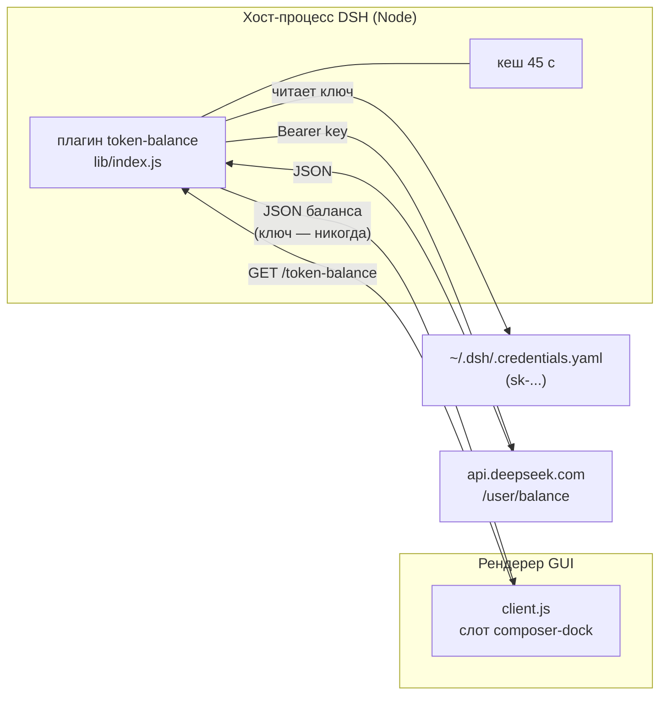

# DeepSeek Balance

**Онлайн-баланс DeepSeek и оценка расхода токенов прямо в панели чата [DeepSeek Harness](https://github.com/deepseek-ai/deepseek-harness).**


<sub>Репозиторий: `deepseek-balance` · id плагина и скилла: `dsh-token-balance` · English version: [README.md](README.md)</sub>


---

## Зачем

DeepSeek Harness и так показывает число токенов и статистику кеша под полем ввода —
но не деньги. Сколько стоила длинная сессия, видно только на странице биллинга
DeepSeek.

Плагин ставит оба числа туда, куда вы и так смотрите: одной строкой под композером.

```
● ¥23.13 · $2.24 · потрачено $0.17
```

- **`¥23.13 · $2.24`** — живой баланс из `GET https://api.deepseek.com/user/balance`
  в обеих валютах, которые отдаёт API (зелёная точка = последний запрос успешен).
- **`потрачено $0.17`** — сколько стоила **эта сессия**, оценка по точным токенам от
  провайдера и официальному прайсу DeepSeek.

Клик по строке открывает подробную раскладку.

## Как это выглядит

**В доке композера** — чип стоит рядом со встроенной статистикой шагов и токенов и
ничего не дублирует:


**В поповере** (клик по чипу) — разбивка баланса, расход сессии в USD и ¥, доля
кеш-хитов, вход без кеша, чтение/запись кеша, выход, всего токенов, время последнего
обновления, кнопка ручного обновления и точные цены, по которым считается оценка:


## Возможности

| | |
|---|---|
| **Живой баланс** | Опрос раз в минуту, кеш на хосте 45 с, ручное обновление в поповере. |
| **Две валюты** | CNY и USD, поиск по коду валюты — никогда по индексу массива. |
| **Точные токены** | Берутся из проекции `tokenUsage`, которую сообщает провайдер. |
| **Пик / вне пик** | Таблица цен выбирается по текущему времени UTC. |
| **Знает модель** | Модель читается из `modelSelection` сессии, цена — по её строке. |
| **Честно про деньги** | Расход помечен как оценка, ¥ — помеченная конвертация (DeepSeek считает в USD). |
| **Тихо деградирует** | При сбое сети или API остаётся последний удачный баланс, точка краснеет. |
| **Без сборки** | Рукописный бандл для `window.__ModuleLoader__` — без бандлера и `node_modules`. |
| **Переживает обновления** | Затрагивается только профиль DSH (`plugins/` + одна строка патча). `app.asar` не меняется. |
| **Обратимо** | `uninstall.ps1` убирает строку патча (с бэкапом), плагин и скилл. |

## Требования

- DeepSeek Harness с Web GUI (десктоп-приложение или `dsh web`), проверено на
  **DSH Desktop 0.2.1-rc.2**.
- Ключ DeepSeek API в `<DSH_HOME>/.credentials.yaml` — тот же, что использует харнесс.
  Чип читает его **в хост-процессе** и никогда не отдаёт в браузер.
- PowerShell 7 (`pwsh`) или Windows PowerShell 5.1.
- Исходящий HTTPS к `api.deepseek.com` из хост-процесса.

## Установка

Три равнозначных способа. Все **идемпотентны** — повторный запуск только обновляет файлы.

**1. Попросить ассистента** (после установки скилла):

> «поставь dsh-token-balance» / «покажи мой баланс DeepSeek»

**2. Запустить установщик самому:**

```powershell
powershell -ExecutionPolicy Bypass -File .\skill\scripts\install.ps1
```

**3. Дважды кликнуть `install.cmd`** — предпочтёт `pwsh`, иначе возьмёт Windows PowerShell.

Затем **обновите окно DeepSeek Harness через `F5`**. Клиентские бандлы читаются один
раз при загрузке страницы, поэтому уже открытое окно продолжает рисовать старый UI.

Установщик пишет ровно в три места:

| Путь | Что |
|---|---|
| `<DSH_HOME>\profiles\<desktop\|web>\plugins\token-balance\` | плагин (3 файла) |
| `<DSH_HOME>\profiles\<desktop\|web>\cordis.patch.yml` | одна помеченная строка `insert` (сначала бэкап с меткой времени) |
| `<DSH_HOME>\skills\dsh-token-balance\` | скилл-компаньон (пропустить: `-NoSkill`) |

`DSH_HOME` по умолчанию `%USERPROFILE%\.dsh`. Ничего внутри установки DSH, её
`app.asar` и `node_modules` не меняется — обновления приложения плагин не ломают.

### Проверка

```powershell
# хост-половина смонтирована и достаёт API
Invoke-WebRequest http://127.0.0.1:<port>/token-balance | Select-Object -Expand Content
# {"ok":true,"at":1792784049918,"available":true,
#  "balances":[{"currency":"USD","total":"2.24","granted":"0.00","toppedUp":"2.24"},
#              {"currency":"CNY","total":"23.93","granted":"0.00","toppedUp":"23.93"}]}

node --check skill/assets/plugin/lib/client.js   # клиентский бандл парсится
```

Порт — это порт GUI (`$env:DSH_WEB_URL`, приложение обычно печатает его при старте).

## Как это работает



- **Хост-половина** — обычный плагин Cordis. Регистрирует `GET /token-balance` на
  `ctx.webServer`, кеширует ответ upstream на 45 с и склеивает одновременные запросы
  через in-flight promise. Ошибки превращаются в `{ ok: false, error }` —
  `no-api-key`, `upstream-<status>` или текст исключения.
- **Клиентская половина** — рукописный CommonJS-бандл для `window.__ModuleLoader__`.
  Регистрирует один контрол в слоте `conversation.composer.dock` (`order: 2`) и читает
  проекции `tokenUsage` и `modelSelection` из пропсов слота. Сборка не нужна,
  зависимостей кроме `react` / `react/jsx-runtime` нет — их даёт платформа.
- **Скилл** — `skill/SKILL.md`, устанавливается в `<DSH_HOME>/skills/`, чтобы будущий
  агент мог поставить, проверить или снести всё, не выводя детали заново.

Глубокие заметки — семантика патча, контракты слотов, формат клиентского бандла и уже
оплаченные грабли — лежат в [`MEMORY.md`](MEMORY.md) и
[`docs/ARCHITECTURE.md`](docs/ARCHITECTURE.md).

## Точность

Токены **точные** — из проекции `tokenUsage`, которую сообщает провайдер. Деньги —
**оценка**: клиент считает их по официальному прайсу DeepSeek из
[`PRICES`](skill/assets/plugin/lib/client.js), USD за 1M токенов, вне пик / пик:

| модель | кеш-хит | кеш-мисс | выход |
|---|---|---|---|
| `deepseek-flash` (V4.1-Flash) | 0.003 / 0.006 | 0.15 / 0.30 | 0.60 / 1.20 |
| `deepseek-v4-pro` | 0.022 / 0.044 | 0.66 / 1.32 | 1.98 / 3.96 |

Пик — 01:00–04:00 и 06:00–10:00 UTC, понедельник–пятница, кроме китайских
государственных праздников; всё остальное — вне пик по половинной цене. ¥ — это
пересчёт по курсу **7.2 CNY/USD**; DeepSeek выставляет счёт в USD, поэтому в поповере
и стоит `≈ ¥`.

Таблица цен проверена на реальном падении баланса: 18 985 856 токенов из кеша +
96 828 без кеша + 107 807 выхода по прайсу Flash вне пик дали **$0.136 ≈ ¥0.98**,
а кошелёк за тот же промежуток просел на **¥1.00**.

Обновляйте `PRICES`, когда DeepSeek меняет цены; ссылка на источник — в комментарии
кода. Сам баланс — это факт из `GET /user/balance`, а не оценка.

## Безопасность и приватность

- Маршрут баланса привязан к веб-серверу харнесса на `127.0.0.1`, отвечает только на
  `GET`/`HEAD` и не отдаёт CORS-заголовков — чужая веб-страница ответ прочитать не может.
- Наружу уходят **только балансы**: ни ключа, ни его префикса, никаких других
  учётных данных. Ключ читается в хост-процессе и используется для одного запроса.
- Ничего не отправляется третьим сторонам: ни телеметрии, ни аналитики, ни других
  эндпоинтов кроме `api.deepseek.com`.
- Плагин не меняет установку DSH, а каждая правка `cordis.patch.yml` предваряется
  бэкапом с меткой времени.
- Любой процесс, который уже умеет говорить с loopback-портом, прочитает те же
  числа — это ровно та же граница доверия, что и у самого харнесса.

## Структура проекта

```
deepseek-balance\
  README.md, README.ru.md          документация (EN / RU)
  MEMORY.md                        инженерные заметки и добытые детали DSH
  AGENTS.md                        указатель для кодинг-агентов
  CHANGELOG.md, CONTRIBUTING.md
  LICENSE                          MIT
  install.cmd, uninstall.cmd       обёртки для двойного клика
  docs\
    ARCHITECTURE.md                поток запроса, контракты, состояния отказа
    images\                        скриншоты для README
  skill\
    SKILL.md                       runbook для агента: установить / проверить / снести
    scripts\install.ps1            установщик
    scripts\uninstall.ps1          удаление
    assets\plugin\package.json     манифест DSH-плагина (dsh.client)
    assets\plugin\lib\index.js     хост-половина: GET /token-balance + ключ + кеш
    assets\plugin\lib\client.js    браузерная половина: чип в доке + поповер
```

## Удаление

```powershell
powershell -ExecutionPolicy Bypass -File .\skill\scripts\uninstall.ps1
```

или двойной клик по `uninstall.cmd`. Добавьте `-KeepSkill`, чтобы оставить скилл.
Оба скрипта принимают `-DshHome <path>` и `-Profile <name>`.

## Если что-то не так

| Симптом | Причина / что делать |
|---|---|
| Под композером нет строки | Страница не перезагружена или в профиле нет строки патча — проверьте `cordis.patch.yml`, затем `F5`. |
| Красная точка, ошибка `no-api-key` | В `<DSH_HOME>\.credentials.yaml` нет ключа `sk-...`; войдите или добавьте ключ. |
| Баланс вечно `···` | Хост-процесс не может достучаться до `api.deepseek.com` (прокси / файрвол). |
| Есть только расход, баланса нет | Маршрут доступен, но upstream вернул не-200; текст ошибки — в поповере. |
| Числа выглядят устаревшими | Кеш upstream 45 с, опрос раз в 60 с; в поповере есть кнопка обновления. |
| Баланс есть, расхода нет | У сессии ещё нет проекции `tokenUsage` — отправьте сообщение, и она появится. |

## Планы

- Необязательная история по дням / сессиям в поповере (данные уже есть в кеше проекций).
- Читать прайс из конфигурации, а не из констант.
- Путь для `web`-профиля при установке через CLI `dsh web` (реализован, но не проверен
  на машине без десктоп-приложения).
- Прятать расход по умолчанию за настройкой.

## Лицензия

[MIT](LICENSE). Проект не связан с DeepSeek; названия использованы описательно.
